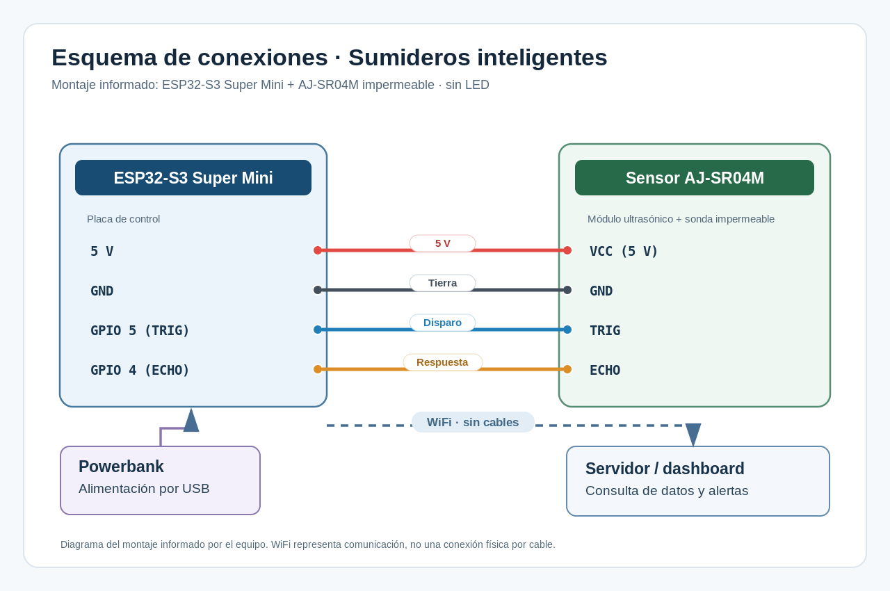

# Sistema detector de nivel anormal en sumidero

Sistema IoT basado en una **ESP32-S3 Super Mini** y un **sensor ultrasónico impermeable AJ-SR04M**, diseñado para monitorear el nivel de agua en sumideros urbanos e identificar posibles situaciones de riesgo asociadas a la acumulación excesiva de agua.

El dispositivo obtiene mediciones de distancia, las procesa y las transmite mediante WiFi a un servidor alojado en **Railway**. El servidor calcula el nivel de agua y se comunica con una base de datos **PostgreSQL alojada en Aiven** para almacenar y consultar los registros mediante una plataforma web.

El proyecto contempla la incorporación de alertas digitales ante niveles de agua anormalmente elevados. Esta funcionalidad se encuentra pendiente de implementación en la versión documentada del software.

> **Curso:** TEI201 — Taller de Diseño en Ingeniería · **Entrega:** Avance 3

## Integrantes del equipo

- Olivia Betinyani
- Joaquín Calderón
- Joaquín Zavala
- Antonia Uribe

## Enlaces rápidos

- **Dashboard:** https://monitor-sumidero-production.up.railway.app/
- **Servidor externo:** Railway, mediante Node.js y Express.
- **Base de datos:** PostgreSQL alojado en Aiven.
- **Documentación por carpeta:** [Hardware](hardware/README.md) · [Software](software/README.md) · [Diseño 3D](diseno-3d/README.md) · [Testing](testing/README.md) · [Iteraciones](iteraciones/README.md) · [Documentación final](documentacion/README.md) · [Fuentes e IA](FUENTES.md)

---

## 1. ODS y problema a resolver

**ODS:** ODS 11 — Ciudades y comunidades sostenibles. Nuestro proyecto contribuye a este objetivo mediante el desarrollo de un sistema de monitoreo del nivel de agua en sumideros urbanos, orientado a identificar aumentos anormales y facilitar futuras alertas tempranas. De esta manera, buscamos contribuir a la seguridad de las comunidades, en concordancia con la meta 11.5, orientada a reducir el impacto de los desastres, incluidos los relacionados con el agua.

**Problema:** La acumulación excesiva de agua en los sumideros urbanos puede generar desbordamientos y anegamientos en calles y veredas, especialmente durante períodos de lluvias intensas. Estas situaciones pueden afectar la circulación de peatones y vehículos, además de representar un riesgo para la comunidad.

Frente a esta problemática, nuestro proyecto busca monitorear el nivel de agua en los sumideros y facilitar la identificación oportuna de posibles situaciones de riesgo, proporcionando información que permita observar su evolución.

**Contexto de instalación:** el equipo está diseñado para instalarse bajo una rejilla de sumidero tipo SERVIU S2, con el sensor orientado hacia abajo, en dirección a la superficie del agua. El encapsulado fue diseñado en Fusion 360 y fabricado mediante impresión 3D (ver [Diseño 3D](diseno-3d/README.md)).

---

## 2. Cómo funciona el sistema

1. La **ESP32-S3 Super Mini** utiliza el sensor ultrasónico impermeable **AJ-SR04M** para medir la distancia entre el sensor y la superficie del agua. El sensor emite una onda ultrasónica que rebota en el agua y regresa, permitiendo calcular la distancia a partir del tiempo de retorno.

2. Para obtener una medición más confiable, el programa realiza **5 lecturas consecutivas**, separadas por intervalos de 60 milisegundos, y calcula la **mediana** de los valores válidos. Esto permite reducir la influencia de lecturas erróneas o ecos aislados.

3. El sistema considera válidas las distancias comprendidas entre **20 y 600 cm**. Si no se obtienen al menos 3 lecturas válidas, se descarta el resultado y no se realiza el envío de esa medición.

4. Cada **10 segundos**, la ESP32 procesa una nueva medición y, si es válida, la transmite mediante WiFi a un servidor externo alojado en **Railway**, utilizando una solicitud HTTPS de tipo POST.

5. El servidor recibe la distancia medida y calcula el nivel de agua utilizando la altura de referencia del sensor respecto del fondo del sumidero:

   `nivel_cm = max(0, ALTURA_SENSOR_CM - distancia_cm)`

   La variable `ALTURA_SENSOR_CM` corresponde a la distancia entre el sensor y el fondo del sumidero. Este parámetro se configura en el servidor y depende de las condiciones de instalación.

6. El servidor se comunica con una base de datos **PostgreSQL alojada en Aiven** para almacenar los registros. La estructura contempla la distancia medida, el nivel calculado, el identificador del dispositivo, el voltaje de batería y la fecha de cada medición.

7. El **dashboard** permite consultar las mediciones almacenadas y representarlas mediante un gráfico del nivel de agua y una tabla de registros.

8. Si el sensor no obtiene una medición válida o se produce un error de transmisión, el programa informa la situación mediante el **Monitor Serial**.

**Alertas digitales:** el proyecto considera incorporar un mecanismo que permita identificar niveles de agua anormalmente elevados y verificar que la condición persista antes de confirmar una alerta. Esta lógica todavía no está implementada en la versión documentada del servidor y del dashboard.

### Lógica de funcionamiento

```text
[ Sensor ultrasónico impermeable AJ-SR04M ]
                       |
                       v
                  [ ESP32-S3 ]
                       |
              Realiza 5 lecturas
                       |
                       v
          [ Validación de mediciones ]
                       |
             ¿Hay 3 o más válidas?
                       |
          +------------+-------------+
          |                          |
          NO                         SÍ
          |                          |
          v                          v
 [ Descarta el dato ]      [ Calcula la mediana ]
                                     |
                                     v
                             [ Conexión WiFi ]
                                     |
                                     v
                       [ Envío HTTPS cada 10 s ]
                                     |
                                     v
                       [ Servidor Railway ]
                         [ Node.js + Express ]
                                     |
                                     v
                        Calcula el nivel de agua
                                     |
                                     v
                       [ PostgreSQL en Aiven ]
                         Almacenamiento de datos
                                     |
                                     v
                       [ Consulta de registros ]
                                     |
                                     v
                              [ Dashboard ]
                                     |
                           Gráfico y tabla de
                               mediciones
```

### Parámetros de operación

| Parámetro | Valor |
| :--- | :--- |
| Microcontrolador | ESP32-S3 Super Mini |
| Sensor | AJ-SR04M ultrasónico impermeable |
| Lecturas por medición | 5 |
| Lecturas válidas necesarias | Mínimo 3 |
| Intervalo entre lecturas | 60 ms |
| Procesamiento | Cálculo de la mediana |
| Distancia mínima programada | 20 cm |
| Distancia máxima programada | 600 cm |
| Intervalo de envío | 10000 ms (10 segundos) |
| Puerto serie | 115200 baudios |
| Conectividad | WiFi de 2.4 GHz |
| Protocolo de comunicación | HTTPS |
| Servidor | Railway (Node.js + Express) |
| Base de datos | PostgreSQL en Aiven |
| Tabla de almacenamiento | `mediciones` |
| Actualización del dashboard | Cada 5 segundos |
| Altura de referencia del sensor | Configurable mediante `ALTURA_SENSOR_CM` en el servidor |
| Umbral de alerta digital | Funcionalidad pendiente de implementación |
| Tiempo de confirmación de alerta | Funcionalidad pendiente de implementación |

---

## 3. Componentes

| Componente | Detalle |
| :--- | :--- |
| Microcontrolador | ESP32-S3 Super Mini |
| Sensor | AJ-SR04M (ultrasónico impermeable, con sonda y cable) |
| Alimentación | Powerbank modelo PB13350 mediante USB. Dimensiones: 100 × 20 × 20 mm |
| PCB perforada | Soporte para la ESP32 y las conexiones del sensor (60 × 40 mm, 38 mm de alto) |
| Encapsulado | Caja impresa en 3D (PLA), diseñada en Fusion 360, con tapa fijada mediante tornillos M3 e insertos de bronce |

La documentación del montaje, las fotografías del prototipo y la lista de materiales con sus costos se encuentran en [Hardware](hardware/README.md).

---

## 4. Conexiones (pinout)

| Señal | Pin / GPIO | Detalle de conexión |
| :--- | :--- | :--- |
| **TRIG** | GPIO 5 | Señal de disparo del sensor ultrasónico |
| **ECHO** | GPIO 4 | Señal de retorno del eco, según el montaje realizado |
| **VCC sensor** | 5 V | Alimentación del módulo ultrasónico |
| **GND** | GND | Tierra común entre la ESP32 y el sensor |
| **Alimentación** | USB | Powerbank conectada a la ESP32 |
| **Comunicación** | WiFi | Transmisión inalámbrica de mediciones hacia Railway |

El montaje del prototipo utiliza las conexiones indicadas, sin LED adicional ni divisor de voltaje instalado. Antes de una implementación permanente, debe comprobarse la compatibilidad eléctrica de la señal ECHO con las entradas de la ESP32-S3.

**Esquemático:** [hardware/esquematico.png](hardware/esquematico.png).



---

## 5. Puesta en marcha

### 5.1 Conectar el prototipo

1. Conectar el sensor ultrasónico impermeable AJ-SR04M a la ESP32-S3 Super Mini según la tabla de conexiones.
2. Verificar que TRIG corresponda al GPIO 5 y ECHO al GPIO 4.
3. Comprobar que el módulo ultrasónico tenga alimentación y tierra común con la ESP32.
4. Alimentar la placa mediante el cable USB del computador o la powerbank.
5. Colocar el sensor orientado hacia la superficie que se desea medir, dentro del rango de funcionamiento programado.

### 5.2 Cargar el código en la ESP32

1. Instalar **Arduino IDE** y el paquete de placas **esp32 de Espressif Systems** desde el Gestor de placas.

2. Instalar la librería **ArduinoJson versión 7** desde el Gestor de Bibliotecas. Las librerías `WiFi.h`, `WiFiClientSecure.h` y `HTTPClient.h` vienen incluidas en el paquete ESP32.

3. Abrir el archivo `monitor_sumidero.ino`, correspondiente al firmware desarrollado para el proyecto. Su funcionamiento se documenta en [Software](software/README.md).

4. Configurar los datos necesarios para la conexión WiFi y la comunicación con el servidor:

   - `WIFI_SSID`: nombre de la red WiFi.
   - `WIFI_PASS`: contraseña de la red WiFi.
   - `SERVER_URL`: dirección completa de la API del servidor.
   - `API_KEY`: clave utilizada para autorizar el envío de mediciones.
   - `DISPOSITIVO`: identificador de la ESP32.

   **Dirección de recepción de mediciones:**

   `https://monitor-sumidero-production.up.railway.app/api/mediciones`

   **Importante:** las contraseñas y claves reales no deben publicarse en GitHub. La `API_KEY` del firmware debe coincidir con la configurada en Railway.

5. Configurar las opciones de la placa en Arduino IDE:

   | Opción | Valor |
   | :--- | :--- |
   | Board | ESP32S3 Dev Module |
   | USB CDC On Boot | Enabled |
   | USB Mode | Hardware CDC and JTAG |
   | CPU Frequency | 240MHz (WiFi) |
   | Flash Size | 4MB (32Mb) |
   | Flash Mode | QIO 80MHz |
   | Partition Scheme | Default 4MB with SPIFFS |
   | PSRAM | Disabled |
   | Upload Speed | 921600 |

   Estas opciones corresponden a la configuración documentada para la placa utilizada; deben ajustarse si la versión específica de la placa requiere otros parámetros.

6. Seleccionar el puerto USB correspondiente a la ESP32 y presionar **Subir**.

7. Abrir el **Monitor Serial a 115200 baudios** para comprobar el funcionamiento del sensor y la comunicación con el servidor.

8. Verificar que la placa se conecte a WiFi, obtenga mediciones válidas y realice solicitudes al servidor.

Cuando una medición se registra correctamente, el servidor devuelve el código HTTP `201`.

### 5.3 Conexión WiFi y consulta de datos

**Conexión WiFi**

1. La ESP32 utiliza las credenciales configuradas en el firmware para conectarse automáticamente a una red WiFi de **2.4 GHz**.

2. Una vez establecida la conexión, obtiene una dirección IP local y queda habilitada para comunicarse con el servidor Railway mediante Internet.

3. Cada 10 segundos, el programa realiza las lecturas del sensor, calcula una distancia representativa y transmite la información si se obtiene una medición válida.

4. Si se pierde la conexión WiFi, la ESP32 intenta restablecerla para continuar transmitiendo las mediciones.

5. El Monitor Serial permite observar las distancias medidas, los errores y los códigos de respuesta del servidor.

**Consulta de datos mediante la página web**

1. El usuario accede al dashboard del proyecto mediante un navegador web.

2. A diferencia de la versión inicial, la ESP32 **no funciona como servidor web local**. Su función es medir y enviar las distancias al servidor externo.

3. Railway recibe la información y utiliza PostgreSQL en Aiven para almacenar y consultar las mediciones.

4. La página web solicita los registros mediante la API y los representa en un gráfico del nivel de agua y una tabla.

5. El dashboard está programado para consultar las mediciones cada **5 segundos**. Esta frecuencia corresponde a la actualización de la página, mientras que la ESP32 genera un envío aproximadamente cada **10 segundos**.

6. Como el dashboard está alojado en Internet, el computador o celular utilizado para consultarlo **no necesita estar conectado a la misma red WiFi que la ESP32**.

**Enlace del dashboard:**

https://monitor-sumidero-production.up.railway.app/

### 5.4 Comunicación con el servidor

La ESP32 transmite las mediciones mediante solicitudes HTTPS de tipo POST a una API alojada en Railway.

El servidor utiliza **Node.js con Express** y se comunica con una base de datos **PostgreSQL alojada en Aiven** para registrar y consultar la información.

**Dirección del servidor:**

https://monitor-sumidero-production.up.railway.app/

**Ruta de recepción de mediciones:**

`POST /api/mediciones`

La comunicación utiliza el encabezado `x-api-key` para autorizar las solicitudes y el formato JSON para transmitir las mediciones.

**Ejemplo de datos enviados:**

```json
{
  "dispositivo": "esp32-sumidero",
  "distancia_cm": 45.5,
  "bateria_v": null
}
```

Este ejemplo representa la estructura de la información enviada:

- `dispositivo`: identificador de la ESP32.
- `distancia_cm`: distancia medida por el sensor, expresada en centímetros.
- `bateria_v`: voltaje de batería. Actualmente se envía `null`, ya que el prototipo utiliza una powerbank por USB y no incorpora medición de voltaje de batería.

**Cálculo del nivel de agua**

El servidor convierte la distancia medida en un nivel de agua mediante la expresión:

```text
nivel_cm = max(0, ALTURA_SENSOR_CM - distancia_cm)
```

`ALTURA_SENSOR_CM` representa la distancia entre el sensor y el fondo del sumidero, configurada como variable de entorno del servidor.

El resultado se expresa en centímetros y no puede ser negativo. Este cálculo permite diferenciar la distancia hasta la superficie del agua de la altura de agua acumulada respecto del fondo.

**Almacenamiento de datos**

El servidor utiliza una base de datos PostgreSQL alojada en Aiven, con una tabla denominada `mediciones`.

La estructura contempla los siguientes campos:

| Campo | Información almacenada |
| :--- | :--- |
| `id` | Identificador del registro |
| `dispositivo` | Identificador del dispositivo |
| `distancia_cm` | Distancia medida por el sensor |
| `nivel_cm` | Nivel de agua calculado |
| `bateria_v` | Voltaje de batería, si está disponible |
| `creado_en` | Fecha y hora de almacenamiento |

El sistema está diseñado para conservar los registros y permitir su consulta posterior a través de la API.

**Rutas de la API**

| Método y ruta | Función |
| :--- | :--- |
| `GET /` | Entrega la página web del dashboard |
| `POST /api/mediciones` | Recibe y registra las mediciones de la ESP32 |
| `GET /api/mediciones?limite=N` | Consulta las mediciones más recientes |
| `GET /api/salud` | Comprueba la disponibilidad del servidor y la conexión con la base de datos |

El dashboard utiliza la consulta `GET /api/mediciones?limite=30` para solicitar hasta 30 mediciones recientes.

Los registros se representan mediante un gráfico y una tabla, que permiten observar la variación del nivel de agua a lo largo del tiempo.

**Visualización de datos**

La interfaz contempla:

- Gráfico de línea del nivel de agua.
- Tabla de mediciones registradas.
- Identificador del dispositivo.
- Distancia y nivel de agua en centímetros.
- Voltaje de batería, cuando esté disponible.
- Fecha y hora de cada registro.
- Hora de actualización de la plataforma.

**Procesamiento de alertas y umbrales**

El proyecto contempla incorporar alertas digitales cuando se detecten niveles de agua anormalmente elevados.

El mecanismo propuesto consiste en comprobar si el nivel supera un umbral y verificar que la condición se mantenga durante un período definido antes de confirmar una alerta. Esta verificación permitiría reducir las falsas alarmas producidas por variaciones momentáneas en las mediciones.

En la versión documentada del software, **esta lógica de alertas todavía no se encuentra implementada**. Actualmente, el servidor se encarga de recibir las mediciones, calcular el nivel de agua y gestionar los registros.

**Estado de la integración con la base de datos**

Durante la revisión técnica realizada el **22 de noviembre de 2026**, se identificó un error de conexión `ENOTFOUND` entre el servidor y el servicio de Aiven. Por este motivo, la consulta de registros y su visualización en el dashboard requieren una comprobación final una vez restablecida la conexión.

La documentación técnica detallada del firmware, servidor, dependencias, configuración y funcionamiento del dashboard se encuentra en [Software](software/README.md).

---

