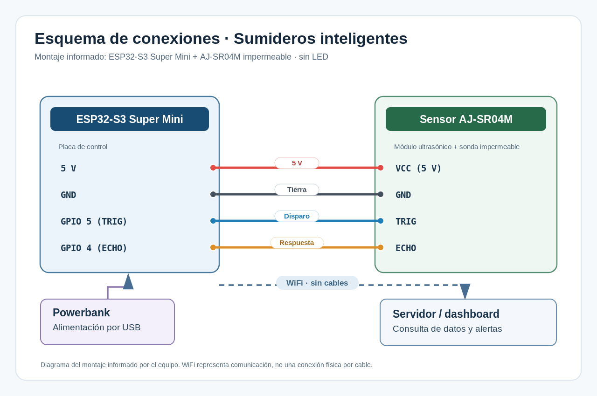

# Hardware

Documentación del prototipo final de monitoreo del nivel de agua en sumideros urbanos.

El sistema está compuesto por una **ESP32-S3 Super Mini** y un **sensor ultrasónico impermeable AJ-SR04M**, alimentados mediante una powerbank por USB.

El sensor mide la distancia hasta la superficie del agua y la ESP32 procesa las mediciones, permitiendo detectar niveles anormales y comunicar alertas mediante WiFi a una plataforma web.

---

## 1. Esquemático y conexiones

### Esquemático del circuito

El siguiente esquema representa las conexiones del prototipo final, compuesto por una ESP32-S3 Super Mini y un sensor ultrasónico impermeable AJ-SR04M, alimentados mediante una powerbank por USB.

### Tabla de conexiones

| Señal | Pin / GPIO | Detalle de conexión |
| :--- | :--- | :--- |
| **TRIG** | GPIO 5 | Señal de activación del sensor ultrasónico |
| **ECHO** | GPIO 4 | Señal de respuesta del sensor, conectada directamente a la ESP32 |
| **VCC sensor** | 5 V | Alimentación del sensor ultrasónico impermeable |
| **GND** | GND | Tierra común entre la ESP32 y el sensor |
| **Alimentación** | USB | Powerbank conectada a la ESP32 |
| **Comunicación** | WiFi de la ESP32 | Transmisión inalámbrica de las mediciones al sistema web |

La ESP32 recibe las mediciones del sensor y las procesa según los parámetros programados. Posteriormente, la información se comunica mediante WiFi a la plataforma digital, donde se visualizan los niveles de agua y las alertas correspondientes.

---

## 2. Modelo exacto de los componentes

| Componente | Modelo / Especificación |
| :--- | :--- |
| Microcontrolador | ESP32-S3 Super Mini |
| Sensor | AJ-SR04M (ultrasónico impermeable, sonda con cable) |
| Alimentación | Powerbank por USB (100 × 70 × 25 mm). Marca, modelo y capacidad: **COMPLETAR** |
| PCB perforada | Soporte para la ESP32 y las conexiones del sensor (60 × 40 mm, 38 mm de alto) |
| Encapsulado | Caja impresa en 3D (PLA), diseñada en Fusion 360, con tapa fijada mediante tornillos M3 e insertos de bronce. Ver [Diseño 3D](../diseno-3d/README.md) |
| Cables y conectores | Conexiones entre ESP32, sensor y alimentación. Cantidad: **COMPLETAR** |

---

## 3. Lista de materiales (BOM)

La siguiente tabla presenta los componentes utilizados para construir el prototipo, incluyendo las cantidades y los costos asociados.

| Cant. | Descripción | Precio unitario | Costo total | Dónde se compró |
| :--- | :--- | :--- | :--- | :--- |
| 1 | ESP32-S3 Super Mini | 0$ | 0$ | Laboratorio DEC |
| 1 | Sensor ultrasónico impermeable AJ-SR04M | 9,990$ | 14,980$ | Mercado Libre |
| 1 | Powerbank por USB | 9,990$ | 9,990$ | Mercado Libre |
| 1 | PCB perforada (60 × 40 mm) | 0$ | 0$ | Laboratorio DEC |
| 4 | Tornillos M5 e insertos de bronce | 2,200$ | 8,800$ | HomeCenter |
| 1 | Filamento PLA para el encapsulado | 0$ | 0$ | Laboratorio DEC |
| 4 | Cables y conectores | 0$ | 0$ | Laboratorio DEC |
| | **TOTAL** | | **33,770$** | |

Los costos deben corresponder a los materiales utilizados en la construcción del prototipo.

---

## 4. Fotografías del prototipo

### 4.1 Vista frontal

### 4.2 Vista lateral

### 4.3 Vista interior

---

## 5. Justificación de selección de componentes

### ESP32-S3 Super Mini

Se seleccionó la ESP32-S3 Super Mini debido a su tamaño compacto, capacidad de procesamiento y conectividad WiFi integrada.

Estas características permiten recibir las mediciones del sensor, procesar la información y comunicarla a una plataforma web sin necesidad de utilizar un módulo WiFi adicional.

Además, sus dimensiones facilitan su integración dentro del encapsulado.

### Sensor ultrasónico impermeable AJ-SR04M

Se seleccionó el sensor AJ-SR04M porque permite medir distancias mediante ondas ultrasónicas sin necesidad de establecer contacto directo con la superficie del agua.

Su sonda impermeable resulta adecuada para un proyecto que contempla la presencia de agua y condiciones de humedad.

El sensor permite monitorear las variaciones del nivel de agua dentro del sumidero y detectar condiciones anormales según el umbral programado.

**Rango de medición y precisión del sensor: COMPLETAR**

### Powerbank

Se utiliza una powerbank como fuente de alimentación, permitiendo que el prototipo funcione sin depender de una conexión permanente a un computador o a la red eléctrica.

Esto facilita su transporte y demostración.

**Modelo, capacidad y autonomía: COMPLETAR**

### PCB perforada

La PCB perforada permite organizar y mantener sujetos los componentes electrónicos, facilitando el montaje y la disposición de las conexiones dentro del encapsulado.

### Encapsulado de PLA

El encapsulado fue diseñado en Fusion 360 y fabricado mediante impresión 3D utilizando PLA.

Su función es alojar los componentes electrónicos, mantenerlos organizados y proporcionar una estructura de soporte.

El diseño incorpora una tapa desmontable mediante tornillos M3 e insertos de bronce, facilitando el acceso a los componentes internos.

Para conocer los detalles del diseño, consultar [Diseño 3D](../diseno-3d/README.md).

---

## 6. Diseño para la reparación

El encapsulado fue diseñado considerando la posibilidad de realizar mantenimiento y reemplazar componentes sin necesidad de destruir la estructura.

Para ello, se incorporó una tapa desmontable fijada mediante tornillos M3 e insertos de bronce.

Este mecanismo permite acceder al interior del dispositivo para:

- Inspeccionar el estado de la ESP32.
- Revisar las conexiones eléctricas.
- Reemplazar componentes en caso de fallas.
- Realizar mantenimiento del sistema.
- Acceder al sensor y su cableado.

**Procedimiento de desmontaje y fotografías: COMPLETAR**

El diseño busca facilitar futuras modificaciones y reparaciones, permitiendo prolongar la vida útil del dispositivo.

---

## 7. Consideraciones técnicas y mejoras futuras

Aunque el prototipo permite realizar mediciones y comunicar información digitalmente, existen aspectos que deben evaluarse antes de considerar su implementación en condiciones reales.

### Protección ambiental

Se debe considerar la protección de los componentes electrónicos frente a la humedad, salpicaduras y otras condiciones presentes en los sumideros.

La sonda del sensor es impermeable, pero los demás componentes requieren una protección adecuada.

### Precisión y rango de medición

Se deben evaluar las mediciones del sensor bajo distintas condiciones para determinar su precisión y comprobar que el umbral de alerta se encuentra dentro de su rango de funcionamiento confiable.

**Resultados de validación: COMPLETAR**

### Autonomía

Se debe evaluar cuánto tiempo puede funcionar el sistema utilizando la powerbank seleccionada.

**Autonomía experimental: COMPLETAR**

### Instalación y mantenimiento

Se debe estudiar la ubicación más adecuada para instalar el dispositivo dentro de un sumidero real, considerando su estabilidad, protección y facilidad de acceso para mantenimiento.

Los resultados de las pruebas del sistema se documentan en [Testing](../testing/README.md).

