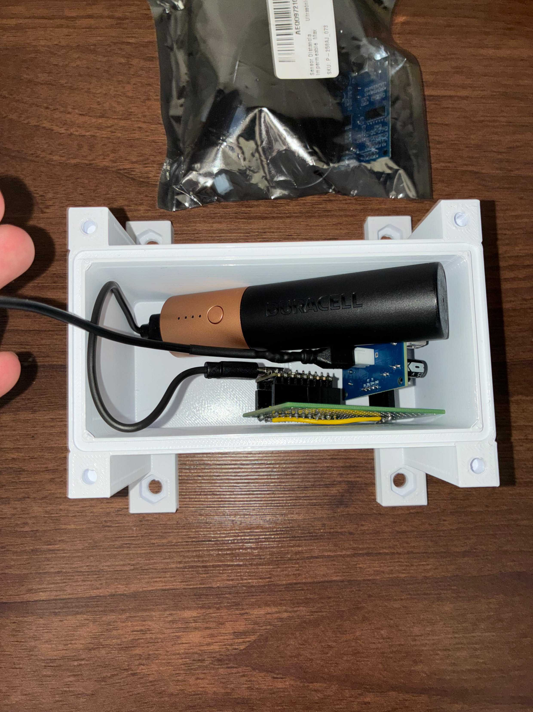
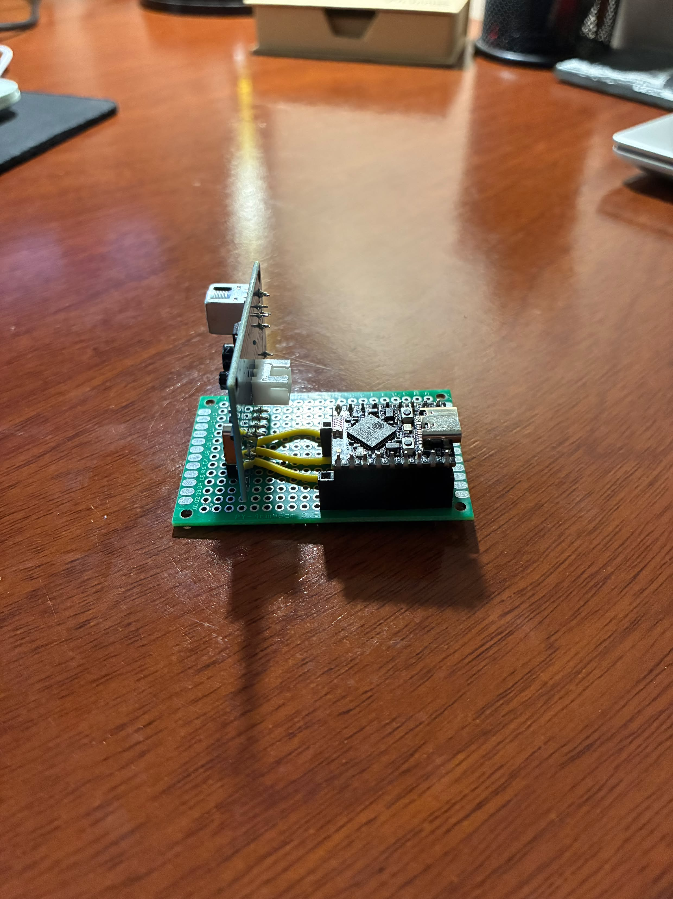
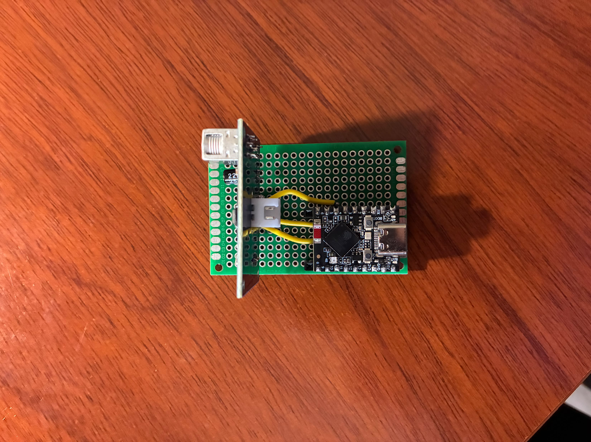

# Hardware

Documentación del prototipo de monitoreo del nivel de agua en sumideros urbanos.

El sistema está compuesto por una **ESP32-S3 Super Mini** y un **sensor ultrasónico impermeable AJ-SR04M**, alimentados mediante una powerbank por USB.

El sensor mide la distancia hasta la superficie del agua y la ESP32 procesa las mediciones mediante cinco lecturas consecutivas, de las cuales calcula la mediana de los valores válidos. Posteriormente, transmite la información mediante WiFi a un servidor externo alojado en Railway.

El servidor calcula el nivel de agua y gestiona su almacenamiento en una base de datos PostgreSQL alojada en Aiven. Las mediciones pueden consultarse a través de una plataforma web.

El proyecto está orientado a identificar aumentos anormales del nivel de agua y contempla la incorporación de alertas digitales como una mejora futura.

---

## 1. Esquemático y conexiones

### Esquemático del circuito

El siguiente esquema representa las conexiones del prototipo, compuesto por una ESP32-S3 Super Mini y un sensor ultrasónico impermeable AJ-SR04M, alimentados mediante una powerbank por USB.

### Tabla de conexiones

| Señal | Pin / GPIO | Detalle de conexión |
| :--- | :--- | :--- |
| TRIG | GPIO 5 | Señal de activación del sensor ultrasónico |
| ECHO | GPIO 4 | Señal de retorno del sensor, conectada directamente a la ESP32 en el montaje realizado |
| VCC sensor | 5 V | Alimentación del módulo ultrasónico |
| GND | GND | Tierra común entre la ESP32 y el sensor |
| Alimentación | USB | Powerbank conectada a la ESP32 |
| Comunicación | WiFi de la ESP32 | Transmisión inalámbrica de mediciones hacia Railway |

La ESP32 controla el sensor ultrasónico y procesa las mediciones según los parámetros del programa.

Cada ciclo de medición considera cinco lecturas consecutivas y requiere un mínimo de tres valores válidos para calcular la mediana.

Posteriormente, el dispositivo envía los datos a Railway mediante una conexión WiFi y solicitudes HTTPS.

El montaje físico no incorpora LED de alerta ni divisor de voltaje. Debido a que la señal ECHO está conectada directamente al GPIO 4, es necesario verificar su compatibilidad eléctrica con las entradas de la ESP32-S3 antes de una operación prolongada.

Para conocer el funcionamiento del programa y la transmisión de datos, consultar [Software](../software/README.md).

---

## 2. Modelo exacto de los componentes

| Componente | Modelo / especificación |
| :--- | :--- |
| Microcontrolador | ESP32-S3 Super Mini |
| Sensor | AJ-SR04M (ultrasónico impermeable, con sonda y cable) |
| Alimentación | Powerbank modelo PB13350 mediante USB, dimensiones de 100 × 20 × 20 mm |
| PCB perforada | Placa de soporte de 60 × 40 mm para la ESP32 y las conexiones del sensor; conjunto montado de aproximadamente 38 mm de alto |
| Encapsulado | Caja impresa en 3D utilizando PLA, diseñada en Fusion 360, con tapa fijada mediante tornillos M3 e insertos de bronce |
| Cables y conectores | Elementos de conexión entre la ESP32, el sensor y la alimentación |

La ESP32 y las conexiones electrónicas se organizan sobre la PCB perforada, la cual se incorpora dentro del encapsulado.

La powerbank permite alimentar el prototipo de manera portátil, sin depender de una conexión permanente al computador.

El diseño del encapsulado se encuentra documentado en [Diseño 3D](../diseno-3d/README.md).

---

## 3. Lista de materiales (BOM)

La siguiente tabla presenta los componentes utilizados para construir el prototipo, indicando sus cantidades, precios registrados y lugares de adquisición.

Los valores corresponden a los costos informados por el equipo. Algunos materiales fueron proporcionados por el Laboratorio DEC, por lo que no representaron un gasto directo para el grupo.

| Cant. | Descripción | Precio unitario o base | Costo total registrado | Dónde se obtuvo |
| :---: | :--- | ---: | ---: | :--- |
| 1 | ESP32-S3 Super Mini | $0 | $0 | Laboratorio DEC |
| 1 | Sensor ultrasónico impermeable AJ-SR04M | $9.990 | $14.980 | Mercado Libre |
| 1 | Powerbank por USB | $9.990 | $9.990 | Mercado Libre |
| 1 | PCB perforada (60 × 40 mm) | $0 | $0 | Laboratorio DEC |
| 4 | Tornillos M3 e insertos de bronce | $2.200 | $8.800 | Homecenter |
| 1 | Filamento PLA para el encapsulado | $0 | $0 | Laboratorio DEC |
| 4 | Cables y conectores | $0 | $0 | Laboratorio DEC |
| | **TOTAL** | | **$33.770** | |

---

## 4. Fotografías del prototipo

En esta sección se presentan fotografías del montaje físico realizado, incluyendo las vistas frontal, lateral e interior del prototipo.

### 4.1 Vista frontal

La vista frontal permite observar la disposición exterior del prototipo y su estructura de soporte.

### 4.2 Vista lateral

La vista lateral permite observar el perfil del montaje y la disposición de sus componentes.

### 4.3 Vista interior

La vista interior permite observar los componentes electrónicos, las conexiones y su distribución dentro del montaje.

---

## 5. Justificación de selección de componentes

### ESP32-S3 Super Mini

Se seleccionó la **ESP32-S3 Super Mini** debido a su tamaño compacto, capacidad de procesamiento y conectividad WiFi integrada.

Estas características permiten controlar el sensor ultrasónico, procesar las mediciones y transmitir la información hacia un servidor externo sin necesidad de incorporar un módulo WiFi adicional.

Además, sus dimensiones facilitan la integración dentro del encapsulado diseñado para el prototipo.

El programa utiliza la ESP32 para realizar cinco lecturas consecutivas, validar los valores obtenidos y calcular la mediana antes de transmitir la medición.

### Sensor ultrasónico impermeable AJ-SR04M

Se seleccionó el **AJ-SR04M** porque permite medir distancias mediante ondas ultrasónicas, sin necesidad de establecer contacto directo con la superficie del agua.

Su sonda impermeable resulta adecuada para un proyecto que contempla presencia de agua y condiciones de humedad.

El sensor permite observar las variaciones de distancia entre su ubicación y la superficie del agua. A partir de esa información, el servidor puede calcular el nivel de agua considerando la altura de instalación del dispositivo.

El firmware utiliza un rango de aceptación de **20 a 600 cm**, descartando las mediciones fuera de esos límites.

Para disminuir la influencia de lecturas incorrectas, se realizan cinco lecturas consecutivas y se calcula la mediana cuando existen al menos tres mediciones válidas.

Este procedimiento busca mejorar la estabilidad de los datos obtenidos, aunque la precisión real del prototipo debe determinarse mediante pruebas experimentales.

### Powerbank

Se utiliza una **powerbank modelo PB13350**, de dimensiones **100 × 20 × 20 mm**, como fuente de alimentación portátil mediante USB.

Esta solución permite utilizar el prototipo sin depender de una conexión permanente a un computador o a la red eléctrica.

Además, facilita su transporte y utilización durante las demostraciones del proyecto.

La autonomía depende de la capacidad de la batería y del consumo eléctrico de los componentes. Por esta razón, no se establece una duración específica sin contar con una medición experimental.

### PCB perforada

La PCB perforada permite organizar y mantener sujetos los componentes electrónicos, facilitando el montaje y la distribución de las conexiones.

Su utilización contribuye a reducir el movimiento de los componentes y a mantener una disposición más ordenada dentro del encapsulado.

También facilita la inspección y el mantenimiento de las conexiones.

### Encapsulado de PLA

El encapsulado fue diseñado en **Fusion 360** y fabricado mediante impresión 3D utilizando **PLA**.

Su función es alojar los componentes electrónicos, mantenerlos organizados y proporcionar una estructura de soporte para el prototipo.

El diseño incorpora una tapa desmontable mediante tornillos M3 e insertos de bronce, lo que facilita el acceso a los componentes internos.

La fabricación mediante impresión 3D permite realizar modificaciones en la geometría del encapsulado y fabricar nuevas versiones si se detectan necesidades de ajuste.

Para conocer los detalles geométricos, planos y modelos del diseño, consultar [Diseño 3D](../diseno-3d/README.md).

---

## 6. Diseño para la reparación

El encapsulado fue diseñado considerando la posibilidad de realizar mantenimiento, inspeccionar las conexiones y reemplazar componentes sin necesidad de destruir la estructura.

Para ello, se incorporó una **tapa desmontable fijada mediante tornillos M3 e insertos de bronce**.

Este sistema permite acceder al interior del dispositivo para:

- Inspeccionar el estado de la ESP32.
- Revisar las conexiones eléctricas.
- Comprobar el estado de la PCB perforada.
- Reemplazar componentes en caso de fallas.
- Inspeccionar el cableado del sensor ultrasónico.
- Realizar ajustes o modificaciones del montaje.

### Procedimiento de acceso a los componentes

1. Desconectar la powerbank para interrumpir la alimentación eléctrica del dispositivo.
2. Retirar los tornillos M3 que fijan la tapa del encapsulado.
3. Separar cuidadosamente la tapa para acceder al interior.
4. Inspeccionar las conexiones, la ESP32 y los componentes montados sobre la PCB.
5. Realizar las operaciones de mantenimiento o reemplazo necesarias.
6. Volver a instalar la tapa y fijarla mediante los tornillos correspondientes.
7. Reconectar la alimentación y comprobar el funcionamiento del dispositivo.

El diseño busca facilitar futuras modificaciones y reparaciones, permitiendo prolongar la vida útil del sistema.

Las fotografías de la sección 4 permiten observar la disposición del prototipo, mientras que los detalles del encapsulado se encuentran en [Diseño 3D](../diseno-3d/README.md).

---

## 7. Consideraciones técnicas y mejoras futuras

Aunque el prototipo está diseñado para medir distancias y transmitir la información digitalmente, existen aspectos que deben evaluarse antes de considerar su implementación permanente en sumideros reales.

### Protección ambiental

Se debe considerar la protección de los componentes electrónicos frente a la humedad, las salpicaduras y otras condiciones presentes en los sumideros urbanos.

La sonda del sensor AJ-SR04M es impermeable, pero esto no significa que la ESP32, la PCB, la powerbank y las conexiones posean el mismo nivel de protección.

El encapsulado de PLA proporciona una estructura física para los componentes, pero no se considera hermético sin una validación específica.

Como mejora futura, se contempla estudiar la incorporación de sellos, protección adicional para las conexiones y medidas que permitan mejorar su resistencia frente al ambiente.

### Precisión y rango de medición

El firmware considera válidas las distancias comprendidas entre **20 y 600 cm**.

Para reducir el efecto de lecturas aisladas, realiza cinco mediciones consecutivas y calcula la mediana de los resultados válidos.

La precisión del prototipo debe evaluarse experimentalmente mediante comparaciones con distancias conocidas.

También es importante comprobar su comportamiento frente a diferentes niveles de agua, condiciones de instalación y posibles interferencias.

Los límites programados de aceptación no constituyen, por sí solos, una validación de precisión de todo el sistema.

### Compatibilidad eléctrica

En el montaje realizado, la señal ECHO del sensor se encuentra conectada directamente al GPIO 4 de la ESP32-S3.

Dado que el módulo ultrasónico utiliza alimentación de 5 V y las entradas de la ESP32-S3 trabajan con niveles lógicos de 3,3 V, es necesario verificar el nivel eléctrico de la señal ECHO.

Para una versión de funcionamiento prolongado, se debe asegurar que esta señal no exceda los límites admitidos por el microcontrolador y, si corresponde, incorporar una adaptación de nivel lógico.

### Autonomía

La alimentación mediante powerbank permite que el dispositivo funcione sin una conexión permanente a la red eléctrica.

Sin embargo, su autonomía real depende del consumo de la ESP32, la frecuencia de las mediciones, el uso del WiFi y la capacidad de la batería.

Para determinarla con precisión se requiere una prueba de funcionamiento continuo, registrando el tiempo durante el cual el prototipo puede mantenerse operativo.

### Conectividad y almacenamiento

El dispositivo utiliza una red WiFi de 2,4 GHz para enviar las mediciones a Railway mediante HTTPS.

Para mantener la transmisión de información, se requiere una conexión disponible y estable.

El servidor está diseñado para almacenar los registros en PostgreSQL mediante Aiven, permitiendo su posterior visualización en un dashboard.

En la revisión técnica del **22 de noviembre de 2026** se identificó un problema de conexión con la base de datos. Por lo tanto, la persistencia y recuperación de mediciones requieren una comprobación final una vez restablecido el servicio.

### Alertas digitales

El proyecto contempla incorporar un sistema de alertas que permita identificar niveles de agua anormalmente elevados.

Como mejora futura, se propone utilizar un umbral de nivel de agua y un período de confirmación para evitar alertas provocadas por variaciones momentáneas.

En la versión actual documentada del software, esta función todavía no se encuentra implementada.

### Instalación y mantenimiento

Se debe estudiar la ubicación más adecuada para instalar el dispositivo dentro de un sumidero real, considerando:

- La estabilidad del montaje.
- La orientación del sensor hacia la superficie del agua.
- La protección de los componentes electrónicos.
- La facilidad de acceso para mantenimiento.
- La disponibilidad de conexión WiFi.
- Las condiciones de funcionamiento del sistema de alimentación.

La implementación definitiva requiere validar estos aspectos mediante pruebas representativas del entorno de uso.

Los protocolos, resultados y observaciones experimentales del proyecto se documentan en [Testing](../testing/README.md).

---

