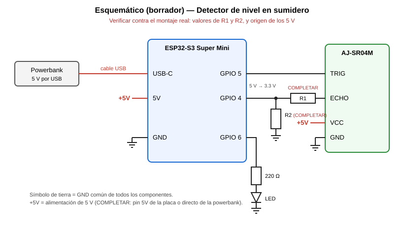

# Hardware

> Todo lo marcado como `COMPLETAR` falta en el repositorio y en el chat de tutoría.

## Esquemático

**Es un borrador hecho a partir del código y del chat.** Revísalo contra el montaje real: faltan los valores del divisor de voltaje y la fuente exacta de los 5 V del sensor. Reemplázalo por el esquemático definitivo (por ejemplo exportado de Fritzing o KiCad) en `esquematico.svg` o `esquematico.pdf`.

### Conexiones

| Desde | Hacia | Observación |
| :--- | :--- | :--- |
| GPIO 5 (ESP32) | TRIG del sensor | |
| ECHO del sensor | Divisor de voltaje → GPIO 4 | El sensor trabaja a 5 V y la ESP32 a 3.3 V |
| 5 V | VCC del sensor | COMPLETAR: ¿del pin 5V de la placa o directo de la powerbank? |
| GND | GND del sensor, del LED y de la ESP32 | Tierra común |
| GPIO 6 (ESP32) | Resistencia de 220 Ω → LED → GND | |
| Powerbank (USB) | Puerto USB de la ESP32 | Alimentación del sistema |

**Divisor de voltaje en ECHO:** R1 = COMPLETAR, R2 = COMPLETAR. (En el chat se sugirió 1 kΩ en serie y 2 kΩ a GND, pero no hay confirmación de lo que se montó.)

## Modelo exacto de los componentes

| Componente | Modelo | Datos |
| :--- | :--- | :--- |
| Placa | ESP32-S3 Super Mini | Chip ESP32-S3 (QFN56, rev v0.2), WiFi, BT 5 (LE), doble núcleo a 240 MHz, flash de 4 MB. LED RGB integrado en el GPIO 48 (se comprobó que parpadea). |
| Sensor | AJ-SR04M | Ultrasónico con sonda separada y cable. ¿Impermeable? COMPLETAR (hoja de datos o vendedor). |
| Alimentación | Powerbank 100 × 70 × 25 mm | Modelo y capacidad: COMPLETAR |

## Lista de materiales (BOM)

| Cant. | Descripción | Precio unitario | Costo total | Dónde se compró |
| :--- | :--- | :--- | :--- | :--- |
| COMPLETAR | ESP32-S3 Super Mini | COMPLETAR | COMPLETAR | COMPLETAR |
| COMPLETAR | Sensor ultrasónico AJ-SR04M | COMPLETAR | COMPLETAR | COMPLETAR |
| COMPLETAR | Powerbank 100 × 70 × 25 mm | COMPLETAR | COMPLETAR | COMPLETAR |
| COMPLETAR | Resistencias del divisor de ECHO | COMPLETAR | COMPLETAR | COMPLETAR |
| COMPLETAR | LED | COMPLETAR | COMPLETAR | COMPLETAR |
| COMPLETAR | Resistencia 220 Ω | COMPLETAR | COMPLETAR | COMPLETAR |
| COMPLETAR | PCB perforada | COMPLETAR | COMPLETAR | COMPLETAR |
| COMPLETAR | Insertos de bronce M3 (3 × 5 × 4 mm) y tornillos M3 | COMPLETAR | COMPLETAR | COMPLETAR |
| COMPLETAR | Filamento PLA | COMPLETAR | COMPLETAR | COMPLETAR |
| COMPLETAR | Cables, conectores y otros | COMPLETAR | COMPLETAR | COMPLETAR |
| | **TOTAL** | | **COMPLETAR** | |

## Fotografías

Mínimo tres ángulos del prototipo ensamblado. Guárdalas en `hardware/fotos/`.

| Archivo | Qué muestra |
| :--- | :--- |
| `fotos/vista-frontal.jpg` | COMPLETAR |
| `fotos/vista-lateral.jpg` | COMPLETAR |
| `fotos/vista-interior.jpg` | COMPLETAR |

## Justificación de componentes

> Borrador: confirma que refleja las razones reales del grupo, y completa las alternativas descartadas, que no constan en el chat.

| Componente | Por qué se eligió | Alternativas descartadas |
| :--- | :--- | :--- |
| ESP32-S3 Super Mini | WiFi integrado para servir la página, USB nativo para el modo Web Serial y tamaño pequeño para caber en la caja. COMPLETAR: razón real del grupo | COMPLETAR |
| AJ-SR04M | Sonda separada del módulo, que permite dejar la electrónica dentro de la caja y el sensor mirando al agua. COMPLETAR: razón real del grupo | COMPLETAR |
| Divisor de voltaje en ECHO | El sensor entrega 5 V y los pines de la ESP32-S3 toleran 3.3 V | — |
| Powerbank por USB | Entrega 5 V regulados y no requiere conexión a la red eléctrica. Por eso no se mide la batería (el voltaje no indica la carga). | COMPLETAR |

## Limitaciones conocidas del sensor (datos del chat, no verificados por el grupo)

* Zona ciega de unos 20–25 cm y alcance de unos 600 cm.
* Pulso de disparo de al menos 10 µs (el código usa 10 µs).
* **Posible inconsistencia:** el umbral de alerta es ≤ 8 cm, menor que la zona ciega indicada. Hay que confirmar con la hoja de datos y con pruebas si ese valor es medible con este sensor, o si el sensor está montado con una separación respecto al nivel del agua. Ver [testing](../testing/README.md).
